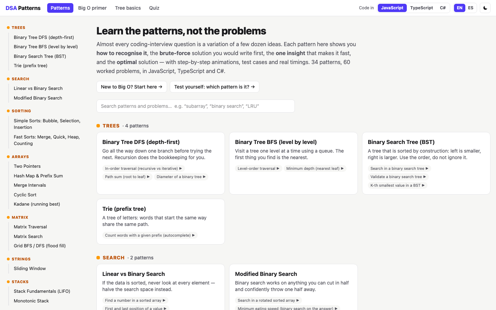

# DSA Patterns

An interactive site for learning the coding patterns behind data-structure and algorithm problems:
how to recognise each pattern, the brute-force solution, the insight, and the optimal solution —
with step-by-step animations, test cases and in-browser timings. Code is shown in JavaScript,
TypeScript and C#.



## Purpose

Most people prepare for coding interviews by memorising solutions to individual problems. That doesn't
transfer: a new problem looks unfamiliar even when it is a disguised version of one you have already seen.
This app teaches the **patterns** behind the problems instead (two pointers, sliding window, hash maps,
and so on), so you can recognise which one applies and derive the solution yourself.

For every problem it walks through the same path:

- **Recognise it** — the signals in the problem statement that point to a pattern.
- **Brute force** — the obvious solution, and why it is too slow.
- **The insight** — the observation that removes the wasted work.
- **The optimal solution** — with its time and space complexity.

To make this concrete rather than abstract, it also includes:

- **Step-by-step animations** that show how the data changes as the algorithm runs.
- **Test cases** that every solution is actually run against.
- **In-browser timings** so you can see the brute-force and optimal approaches diverge as the input grows.
- **Code in JavaScript, TypeScript and C#**, so you can follow along in the language you use.

## Run it

```bash
npm install
npm run dev
```

Then open http://localhost:5173.

## Commands

| Command | What it does |
|---|---|
| `npm run dev` | Start the app |
| `npm test` | Run every solution against its test cases, compare approaches on random inputs, check the animations |
| `npm run check:csharp` | Compile every C# snippet (needs the .NET SDK) |
| `npm run build` | Type-check and build for production into `dist/` |

## How the content is organised

Each problem is two files in `src/content/<group>/`:

- `name.ts` — the real, executed TypeScript solutions (inside `// #region <approach>` blocks), the test
  cases, the benchmark input generator, the animation trace and the explanations.
- `name.cs` — the same approaches in C#, in regions with the same names.

JavaScript is generated from the TypeScript by erasing the types (see the plugin in `vite.config.ts`),
so the two cannot drift. C# cannot run in a browser: it is display-only, and all timings come from the
JavaScript engine.

A trailing `// @step-name` comment marks the line the animation highlights for that step; it is stripped
before the code is displayed and must exist in all three languages (the test suite checks this).

A pattern is a file exporting a `Pattern` object that lists its problems; it is picked up automatically.
